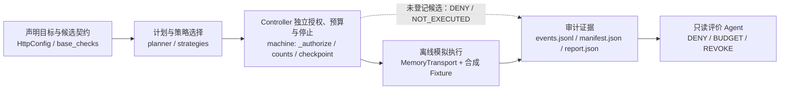

# P3 面向软件验收阶段的黑盒授权安全测试 Agent

P3 面向软件验收阶段的**黑盒 HTTP JSON API 安全检查**：提供受独立授权控制的离线模拟执行，以及基于已有证据的只读评价。项目强调**声明目标、授权边界、确定性策略、Controller 强制控制与证据留痕**。

当前交付范围为**离线模拟与只读评价**；真实 HTTP 组件已存在但尚未获得执行授权，P3 **未在真实系统上执行安全测试**。

[项目文档索引](docs/INDEX.md)是仓库级唯一总入口，本页只提供概要导航。

## 项目概述

| 项 | 说明 |
|---|---|
| 目标用户 | 软件测试人员、验收人员 |
| 使用阶段 | 集成测试与交付前验收 |
| 被测对象 | 本地隔离的合成 HTTP JSON API（黑盒，不要求被测系统源码） |
| 要解决的问题 | 授权边界是否被强制执行、拒绝是否有据可查、工具自身是否会越权派发 |
| 当前交付范围 | 离线模拟（`NO_NETWORK_SIMULATION`）与只读评价 |
| 技术栈 | Python 3.9+，仅标准库，无第三方运行时依赖 |

核心工程思路：

1. 用**接口契约与预期权限矩阵**声明“允许测什么”，不让模型或自然语言自行扩权；
2. 由**确定性策略**从已登记候选中选择下一项检查（`fixed-v1`、`evidence-priority-v1`）；
3. **Controller 独立授权**：候选校验、预算、计数、停止与撤权不依赖 Planner 的意图；
4. 在**离线模拟**中执行，生成可校验的审计证据（事件、Manifest、报告）；
5. 由**独立的只读评价 Agent** 复核拒绝链、预算计数与撤权顺序，不调用产品执行入口。

## 核心能力

| 能力 | 当前状态 | 说明与入口 |
|---|---|---|
| 授权边界与候选校验 | 已实现（离线证据） | 未登记候选返回 `DENY / NOT_APPROVED_CANDIDATE`，不派发；见 [machine.py](src/p3_core/http/machine.py) |
| Planner / Controller 分离 | 已实现（同进程模块分离） | Planner 只提出候选；授权、预算与停止由 Controller 侧独立判定；**不宣称物理隔离** |
| 固定与动态确定性策略 | 已实现；参见 ADR-005 | `FixedSelection` / `EvidenceSelection` 只负责选择；见 [strategies.py](src/p3_core/http/strategies.py) |
| 离线模拟执行 | 已实现 | `MemoryTransport` + 合成夹具；`execution=NOT_EXECUTED`、`request_count=0` |
| 审计事件与证据验证 | 已实现 | `events.jsonl` / `manifest.json` / `report.json`；`delivery verify` 校验内部一致性 |
| 只读评价 Agent | 已实现 | DENY / BUDGET / REVOKE 三条规则；见 [evaluator.py](src/p3_core/evaluator.py) |
| 真实 HTTP 验收准备 | 设计、代码与状态清单已就绪；**未授权** | 14 项仍为 `PENDING_AUTHORIZATION`；见 [状态清单](eval/P3_http_integration_status.json) |

> 单元测试与模拟验证不等于真实运行验收。P3 不声称已完成真实目标的安全测试，也不把 `PASS` 扩大为整体系统安全结论。

## 系统架构



上图为**同进程模块关系**：Planner、策略、Controller 授权与执行器在同一进程内分离，不构成进程隔离、物理隔离或独立操作系统派发防护。

| 模块 | 职责 |
|---|---|
| [contract.py](src/p3_core/http/contract.py) | 接口契约、候选检查与配置校验 |
| [strategies.py](src/p3_core/http/strategies.py) | 固定／动态确定性选择（只选不授权） |
| [machine.py](src/p3_core/http/machine.py) | 受控 HTTP 模型：授权、预算、计数、撤权与停止 |
| [protocol.py](src/p3_core/http/protocol.py) | 响应判定与证据投影 |
| [audit.py](src/p3_core/http/audit.py) | 证据完整性与关联校验 |
| [experiments.py](src/p3_core/experiments.py) | 离线场景与固定／动态对照 |
| [delivery.py](src/p3_core/delivery.py) | 离线交付 CLI 入口 |
| [evaluator.py](src/p3_core/evaluator.py) | 独立只读评价 Agent |
| [planner.py](src/p3_core/planner.py)、[controller.py](src/p3_core/controller.py) | 早期离线核心：原 Planner 与独立授权／预算／停止 |

## 当前工程进度

| 类别 | 状态 |
|---|---|
| 内部工程 | 离线核心、受控 HTTP 模型、审计、策略、只读评价器与 CLI 已实现，并有离线验证与回归记录 |
| 历史实验 | 固定／动态对照共 36 次（24 次完成、12 次安全停止），归档于 [course_ch04](evidence/course_ch04/strategy_history_36/README.md)；执行版本 `NOT_FULLY_BOUND` |
| 内部工程决策 | ADR-005：**Accepted — 2026-11-16，仅限当前离线模拟工程基线**；Fixed（`fixed-v1`）保持默认，Dynamic（`evidence-priority-v1`）继续作为对照，见[正式接受记录](review/P3_adr005_acceptance_20261116.md) |
| 课程正式验收 | 未完成：C-02 未全部完成、REQ-021 未正式验收、教师评分契约与班级预算尚未批准／冻结 |
| 真实 HTTP | 14 项仍为 `PENDING_AUTHORIZATION`；独立 OS 未派发证明 `UNAVAILABLE` |

ADR-005 的接受范围不包含统计优势结论：现有 36 次实验**未观察到**两种策略在覆盖、检出与模拟请求数上的差异，仅支持“暂时保留 Fixed”的保守选择。

## 本地运行与验证

在仓库根目录（PowerShell）执行；以下命令均为**离线操作**，不建立真实网络连接、不启动监听、不扫描外部目标：

```powershell
$env:PYTHONPATH = 'src'
$env:PYTHONDONTWRITEBYTECODE = '1'

# 离线回归（不建立真实网络连接）
python -m unittest discover -s tests -v

# 离线模拟：在 $env:TEMP 下新建输出根目录；每次运行生成唯一 run 子目录，不覆盖已有证据
$runRoot = Join-Path $env:TEMP "p3-review-runs"
$sim = python -m p3_core.delivery simulate --mode good --strategy fixed --output $runRoot | ConvertFrom-Json
$runDir = Join-Path $runRoot $sim.report.run_id

# 读取该 run 生成可读摘要（只读，不重放）
python -m p3_core.delivery offline --run $runDir

# 校验该 run 的证据内部一致性（只读，不证明来源可信或批准真实）
python -m p3_core.delivery verify $runDir

# 独立只读评价（只读三份文件；退出码 0 只表示评价完成，不等于 PASS）
python -m p3_core.evaluator --run $runDir --all
```

说明：

- `$runDir` 指向本次模拟生成的真实 run 子目录；`offline --run`、`verify`、`evaluator --run` 均只读取该目录，不重放、不覆盖已有证据。
- 重复执行 `simulate` 会在同一 `$runRoot` 下新增唯一 run 子目录（`JsonlEvidence` 独占创建，UUID 冲突即失败），不会覆盖历史 run。
- 三种操作含义不同：**模拟运行**产生新证据；**证据校验**只检查内部一致性；**只读评价**只读三份已有文件。
- 退出码不表示安全验收；自动化调用需读取 JSON 的 `status` / `integrity`。
- Python 3.9+，仅标准库。完整参数见[离线交付手册](docs/P3_offline_delivery.md)与[评价手册](docs/P3_minimal_evaluator.md)。

## 文档导航

| 类别 | 入口 | 说明 |
|---|---|---|
| 规格与需求 | [RC2 工程规格](brief/P3_specification_v1.0-rc2.md)、[授权边界](brief/P3_authorization_boundary.md)、[决策治理](brief/P3_decision_governance.md) | 需求 ID、计数口径、批准与授权分工 |
| 系统设计与 ADR | [设计与 ADR 索引](design/README.md)、[ADR-005](design/ADR_005_deterministic_strategy_comparison.md) | 架构决策与当前正文状态 |
| 开发规则与运行手册 | [开发规则](AGENTS.md)、[离线交付手册](docs/P3_offline_delivery.md)、[评价手册](docs/P3_minimal_evaluator.md) | 入口、参数、退出码与边界 |
| 测试与需求追踪 | [需求追踪](eval/P3_requirement_traceability.md)、[`tests/`](tests/) | 需求—设计—实现—验证映射 |
| 实验及证据归档 | [实验与评价证据索引](eval/P3_experiment_evidence_index.md)、[36 次归档](evidence/course_ch04/strategy_history_36/README.md) | 批次、来源与限制 |
| 课程交付与人工复核 | [课程交付索引](review/P3_course_delivery_index.md)、[ADR-005 接受记录](review/P3_adr005_acceptance_20261116.md) | 章节材料、复核状态与未完成事项 |

## 当前限制与后续工作

- **C-02 未全部完成**：正式实验卡预注册、样本量口径与人工成本仍缺。
- **REQ-021 正式课程验收未完成**：离线比较已有，但未达到课程正式验收要求。
- **真实 HTTP 未授权**：14 项验收仍为 `PENDING_AUTHORIZATION`，需目标所有者许可与教师目录记录。
- **独立 OS 未派发证明缺失**：`actual_unauthorized_dispatches=0` 是离线环境中的写定记录值，不构成操作系统层面的未派发证明。
- **历史执行版本未完全绑定**：36 次实验为 `NOT_FULLY_BOUND`，不能声称归档结果等于当前 HEAD 行为。
- **人工成本未测**：准备与复核时间为 `NOT_MEASURED`，不作为总成本或性价比结论。
- **教师审批未完成**：正式评分契约与班级预算冻结尚未取得；ADR-005 的内部接受不等于教师批准或课程验收。

本仓库不授予任何真实目标执行许可；涉及真实 HTTP 的步骤须另行取得授权。
