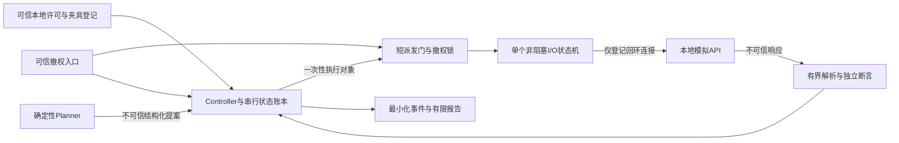

# P3 本地 HTTP 接入设计

修订：2026-10-19，仅澄清竞争边界、授权登记和异常响应；未实现或执行新测试。

日期：2026-10-14。状态：**Draft／待审核；仅设计，不表示实现或测试完成**。本地分析基线 `a1f8abb`，包含离线核心提交 `b3a0da7`。用户确认上一阶段 49 项本地测试及 GitHub Actions 成功；本轮未重跑、未联网复核 CI，不改写历史验证记录。

依据：[RC2](../brief/P3_specification_v1.0-rc2.md)、[授权边界](../brief/P3_authorization_boundary.md)、[ADR-003](ADR_003_local_execution_and_evidence.md)。契约见 [HTTP 契约草案](../brief/P3_http_contract_draft.md)，验收见 [计划](../eval/P3_http_acceptance_plan.md)，重要新取舍见 [ADR-004 Proposed](ADR_004_http_dispatch_and_cancellation.md)。

## 1. 仓库分析与迁移边界

已阅读 README、RC2、治理与边界、ADR-001～003、GWT、离线验证记录、全部 p3_core 模块、测试、离线 JSON 和 CI。当前工作区仅有三份历史未跟踪 Evidence，保持原样。

| 当前能力 | HTTP 接入需要设计的新边界；本轮不改代码 |
| --- | --- |
| models.py 只接受 offline、冻结候选与精确权限组合 | 独立 http-local schema，许可材料核验、路径／查询分离、响应断言和凭据引用绑定；不能只改 mode 字符串 |
| FixedPlanner 从批准候选生成固定列表 | 保留；不接入 LLM、不开发动态策略、不静默裁剪超限计划 |
| Controller.round／_attempt 在同步 RLock 内处理检查 | 拆分短临界区的状态迁移与异步 I/O 生命周期；保留原计数、追加优先于完成、终态及重复 ID 修复 |
| Revocation.dispatch_if_active 持有 gate 执行回调 | 只适用非阻塞假派发；不能把 connect/request/read 放入该回调 |
| request_count 恒为 0，离线派发另计 | 新增真实发送事实事件；不把 ALLOW、入队、连接或模拟回调计为请求 |
| 最小化未批准提案摘要、可信候选字段才留证 | 保留；HTTP 响应也视为不可信输入，不能直接交现有通用 Redactor 后全量存储 |
| JSONL＋Manifest 前缀哈希、有限报告 | 增加请求阶段、响应断言、截断／取消／迟到与来源字段；不覆盖旧 Schema／旧运行 |
| unittest 使用 socket 禁止与临时目录；CI 只跑离线 | 保留；需要授权的 HTTP 集成测试独立入口，不能默认随 push 运行 |

旧原型不移除；不改变现有 49 项测试的正确安全预期。若设计落地需改动同步接口或 schema，应先批准 ADR-004，再以独立测试适配，不能在本轮顺手修代码。

## 2. 信任边界与模块职责

可信宿主按契约 §7.1 的人工核验与本地快照流程核验许可、管理夹具、固定目标和加载只读快照；Planner 只读候选。Executor 只消费 Controller 为当前 run 登记的一次性对象，不能接受任意 URL／自然语言／方法／自带头字段。响应与 Location 不能更新策略、授权、端点、预算、凭据或结论标准。

拟议 `ApprovedExecution` 包含 run_id、slot_id、attempt_id、action_id、授权 generation／版本、精确目标、endpoint_id、method、规范 request-target、identity_ref／credential_ref、契约与矩阵版本、单调截止、一次性许可句柄。仅由可信入口创建并登记；Executor 校验句柄与不可变对象的一致性，拒绝重放、跨 run、过期或变造对象。对象序列化不包含原始 Token。同进程对象能力只是应用入口约束，不保证抵御任意同进程恶意 Python 代码。

所有身份解析以可信 fixture 映射为准，不把响应中的用户名或角色当授权事实；可信核验记录、服务启动记录和请求动作关联用于判断来源。loopback 只能限制地址，不能单凭端口号证明对端就是指定进程；可信服务管理器持有本次服务实例、就绪记录及端口占用生命周期，发现实例退出／重启／被替换立即撤权，不自动重连。对可攻击宿主的其他进程不承诺隔离，需求扩大时重评部署。

## 3. 目标、协议及规范化取舍

| 议题 | 比较与推荐设计 |
| --- | --- |
| 目标固定 | 不使用 hostname 解析后缓存；首版只接受已登记的 IPv4 字面量 127.0.0.1 与确切端口，按该 sockaddr 建连。连接成功后核对 peer IP／port，发凭据前再次核验；不对任意返回地址发起第二连接 |
| 代理 | 高层 opener 配空代理仍需防默认处理器及回退；推荐专用标准库 socket 传输路径，不读取 HTTP_PROXY／HTTPS_PROXY／ALL_PROXY／NO_PROXY／系统代理，不建立 CONNECT 隧道。不靠清空全局环境来修改其他程序 |
| 重定向 | 任何 3xx 作为当前响应证据，默认 INCONCLUSIVE 并按非预期响应安全停止；不解释 Location 为新执行目标、不转发凭据、不派发第二请求。测试用外部 Location 仅是数据，绝不连接 |
| 重试 | 每个检查只有一个连接／发送生命周期；连接拒绝、复位、读写失败后停止，不重新请求。非阻塞暂不可读写后的等待，以及同一请求未发送完的剩余字节，不是自动重试；永远不得从 offset=0 重发 |
| 规范化 | 不接受 Planner 的 URL。参数按契约有限枚举匹配后从模板构造，结果作为同一不可变对象供校验和派发；禁止先校验一种编码再由 Executor 重新拼另一种。首版拒绝百分号、重复 query、点段等，而非多次解码 |
| HTTP 范围 | 只读 GET、无 body、每检查新连接并主动关闭，无 keep-alive 池、HTTP/2、认证挑战重试、压缩或 chunked 发送；固定 Host 与已登记目标一致 |
| 解析 | 推荐窄化 HTTP/1.1 响应边界，完整状态行／头部后按单一 Content-Length 有界读取；重复或冲突长度、TE/CL 混用、chunked、压缩、超长头部、非法 JSON／重复 key 为非预期响应。不为处理恶意响应实现任意通用协议功能 |

标准库路线沿用 ADR-003。推荐以 socket／selectors 管理非阻塞连接和发送；HTTP 头解析可在已经有界收齐的内存块上使用标准库解析辅助。不得把需要阻塞 socket 的解析调用藏回撤权锁里。以上是拟议约束，不是对未来实现或当前 Python 版本行为已验证的声明；下一轮先离线验证字节和解析边界，再经授权做集成测试。本轮不联网查询技术文档。

## 4. 在途方案比较与推荐

| 方案 | 取消能力 | 风险与成本 | 结论 |
| --- | --- | --- | --- |
| A：单受控工作线程＋阻塞标准库 HTTP 客户端 | 主线程可及时标记撤权，设置剩余 socket timeout，尝试 shutdown／close；Python 线程不能无条件强制终止 | 代码较少，但 request() 常含连接和多次发送，短派发门与首字节计数难精确观测；整次调用加锁会阻塞撤权；只在调用前检查存在竞态，跨线程关闭行为需实测 | 不直接采用当前锁包阻塞调用；可作对照原型，不宣称已符合边界 |
| B：分离派发状态机＋单 I/O 所有者，非阻塞 socket／selector | 等待不持锁；每次 connect／write 前核验，撤权唤醒状态机并由其关闭 socket；单次 send 非阻塞 | 状态、部分发送和 HTTP framing 处理更多；仍受 OS 调度与短系统调用延迟影响，不是硬实时保证 | **推荐，Proposed**；最容易把撤权、预算与发送事实的顺序做成可验证边界 |
| C：独立子进程执行 | 可终止进程并回收其句柄，但不能撤回已发字节 | IPC、进程回收、计数确认和崩溃证据复杂；不是默认安全隔离 | 当前不采用；需要隔离或 B 无法满足验证时重评 |

推荐 B 可以有一个专属 I/O 线程，但关键是分离状态机与非阻塞操作，而不是“线程可杀死请求”。禁止每个检查不断创建失联线程；并发始终最多一个动作在途，取消后未确认释放资源前不能派发下一项。

### 4.1 锁和事件协议

Controller 负责串行登记／尝试／判定；I/O 所有者只推进一次性执行对象并回报事实。短 gate 与可信撤权入口共享，保护授权 generation、撤权位、当前 action、一次性发送标志及真实请求计数。撤权在取得 gate 后永久置位并递增 generation，立即唤醒 I/O；不等待 Controller 的磁盘写入、网络返回或线程 join。锁内禁止磁盘 I/O、阻塞等待、凭据外部解析及任意用户回调。

连接准备（也是网络动作）必须在 t0 后、计划登记和首次授权后；非阻塞 connect 的最终复核、单次系统调用和返回状态登记必须处于同一次 gate 临界区，不能核验后解锁再 connect。连接不计 HTTP request_count。接收等待及 selector 等待不持 gate。连接成立后核对 peer、实例和剩余许可，生成最终请求字节；原始 Token 只存在受控内存发送缓冲区，销毁时尽力减少引用，不保证 Python 字符串可安全擦除。

最终发送步骤：先持久记录最小化授权／发送准备事件，释放审计路径；取得 gate，重查 RUNNING、未撤权、generation／许可有效期、审计健康、唯一 active action、首写未消费或续写属于同一 active action、原连接和精确偏移，以及 `now < deadline`。只进行一次非阻塞 send 调用，随返回值更新同一账本后释放锁。若暂无可写空间，等待后重新走全部 gate 校验。部分发送后继续同一请求的剩余字节，每次也重查，绝不重置偏移、换连接或回收名额。

撤权先在 gate 生效则不得再 send；首批字节先成功交给本地 socket 则属于既已派发在途请求，随后撤权不能抹去计数。短 send 仍可能跨过墙上观察到的截止瞬间；以门内单调检查和系统调用顺序留证，不宣称纳秒级或硬实时截止。测试必须覆盖临界区前后及等待阶段，测量撤权生效延迟；超过可接受范围要重评，不用持锁长等待掩盖失败。

I/O 线程不在持 gate 时获取 Controller 主锁；结果通过带 run_id／action_id／generation 的队列交回。Controller 只接纳当前动作一次结果，过期回调、重复结果只能附加留痕，不能复活运行。即使 Controller 正忙于审计，可信撤权入口也能设置禁止发送位。审计失败同样通过可信停止信号禁发。

### 4.1.1 线性化与竞争顺序

这里的“原子性”仅指进程存活期间、所有读写遵守同一 gate 的内存状态可串行观察；不是网络、内存和磁盘的事务。可信停止／失效标志也通过该门发布。快照观察者在门内读取计数与 action 状态，不能读取一半更新。

| 竞争点 | 门内步骤及观察结果 |
| --- | --- |
| connect 与撤权 | 最终检查 → 一次非阻塞 connect → 登记连接中／成功／失败后释放门；connect 先行可能已产生 TCP 流量，但 request_count 仍 0。EINPROGRESS 后仅等待和核验完成，不重复 connect；撤权先行则连 connect 都不得调用 |
| connect 完成与首写 | 连接完成不是发送许可；即使已核验 peer，首写仍必须重新进门核对 generation、许可、时间及停止位。两者之间撤权则关闭连接、HTTP 字节 0、request_count=0 |
| 首次正字节 send | 门内检查 → 单次非阻塞 send → 返回 n>0 后，在释放门前同时置 dispatch_started、offset+=n、request_count+=1。撤权不能插入 send 返回与内存记账之间；同一 action 后续不再增加 request_count |
| 部分发送 | dispatch_started 不等于禁止同一请求续写；续写须匹配原 action、generation、连接与 offset，重新检查停止位后只发剩余字节。暂不可写不改偏移；send=0 或明确失败按传输错误处理，不重发。撤权后续写为 0，已计的 1 不回收 |
| 撤权调用与生效 | 区分入口收到请求的时间和门内 revoked=true、generation 递增的生效序号；确认返回必须晚于生效。先获门的短调用可完成并记账，后获门的撤权阻止随后所有 connect/send。不得把调用到达时刻伪称生效或承诺零调度延迟 |

门内只做一次非阻塞系统调用，不循环写完全部请求；可写等待、日志、清理都在门外。门内序号记录 send 与撤权先后，再在门外持久化；重复撤权幂等，不回收预算。内核已接受字节可能在撤权生效后继续到达服务端，关闭连接不是撤回请求；只承诺生效后不再由应用调用 connect/send。

在“send 已返回正数、内存记账尚未完成”处若进程崩溃，持久证据可能只剩准备事件；恢复报告必须标发送事实未知／审计缺口，不补猜 0 或 1、不自动重试。门内返回后跨过截止时刻也须如实记录已发事实，下一检查点按 RC2 停止；不声称硬实时撤回。

确定性测试用脚本化假传输、门事件序号及可注入单调时钟控制竞争顺序，不用 sleep 碰运气；细项见验收计划 HTTP-T27～T31。假传输的模型计数只用于断言状态机，不能进入真实运行的 HTTP 派发统计。

### 4.2 三计数及真实发送微边界

RC2 §4 原文不变。拟议实现将“实际派发 HTTP 请求”具体落在**该 action 第一次非阻塞发送返回正字节数**：请求字节已交本地网络栈，request_count 恰加 1；不证明服务器已收到完整请求。准备、排队、ALLOW、建立 TCP、send 暂不可写或零字节失败均不加。部分发送后失败仍计 1，禁止重新发送。一个 HTTP 请求分多次 send 只计 1。

| 情形 | plan_count / attempt_count / request_count 增量 |
| --- | --- |
| 登记合法初始或新追加检查 | +1 / 0 / 0 |
| 接纳该已登记检查首次校验（以后可能 DENY） | 0 / +1 / 0 |
| 未登记畸形提案 | 分配 slot 后 +1 / +1 / 0；保留拒绝记录 |
| 相同注册 ID 的冲突／重复提案 | 0 / 0 / 0；原合法检查不被执行、取消或处理 |
| 首次发送正字节数 | 0 / 0 / +1；与 action 消费在同一短门内记录 |
| 连接失败、发送前撤权、审计失败 | 0 / 已消耗尝试保留 / 0；不退还名额 |
| 已登记 8 项后 RUNNING 收到第 9 项 | 0 / 0 / 0，STOPPED/BUDGET_EXHAUSTED；单独未覆盖记录 |

离线 fake 仍只增 offline_dispatch_count，绝不借此测试 request_count 的真实值。试跑保持 `request_count <= attempt_count <= plan_count <= max_checks`；第 8 项可正常完成，终态追加不重开。网络失败分 phase=connect／write／read；响应缺失不等于未派发。若进程在发送与持久审计之间崩溃，不能声称可原子提交“网络＋磁盘”；标记证据缺口／发送事实不确定，不自动重试、不把日志缺失当成 0 请求。

## 5. 状态机、超时与终态

运行仍只使用 READY → RUNNING → COMPLETED 或 STOPPED，不新增可重开的运行状态。下面是一个 action 的内部阶段，不替换 RC2 的运行／执行枚举：

`REGISTERED → VALIDATING → AUTHORIZED → PREPARED → CONNECTING → WRITING → READING → OBSERVED → EVALUATED`。

DENY 直接变为已处理的 NOT_EXECUTED／INCONCLUSIVE。连接或发送失败返回 ERROR；收到可识别的完整 HTTP 状态行和头部即有 HTTP 响应事实，包含 401／403／404／5xx，执行状态为 EXECUTED，响应体是否完整另记。无响应而超时为 TIMEOUT。撤权取消可沿用 RC2 已有 CANCELLED；用户常用四态视图不能删除该枚举或把取消伪装为 EXECUTED。

总截止 `t0 + logical_timeout_seconds` 不重置；每次连接、等待、读取和写入受当前剩余时间与许可截止的较早者限制，阶段 timeout 不能累计出多个 90 秒。单请求上限可作为更小的试跑参数，但不得大于剩余运行预算。初始 Planner 到点时无登记／尝试／连接／请求；最后响应与证据处理恰到点时 STOPPED/BUDGET_EXHAUSTED，不能 COMPLETED。

同检查点原因顺序仍为 REVOKED、AUTHORIZATION_INVALID、运行错误、预算耗尽；时间预算优先于单请求 TIMEOUT，记录所有同时观察到的条件。撤权／到点后不再写请求剩余字节，尽力取消／关闭连接；已发送字节不可撤回。记录取消请求、资源关闭结果、已发送字节数是否已知及清理耗时，不把“取消已申请”写成“已取消完成”。

Controller 处理响应和运行中审计后，先处理该轮待决追加，再做完成判断；负向响应若等待合法对照，其业务判定仍未完成，不以“收到 403”作为全部检查结束。只要仍有有价值的批准检查、必要对照或在途处理，NO_NEW_EVIDENCE 不适用。每个状态变更都核验停止原因；停止时冻结原结论及未完成项。迟到结果只追加 `late_observation`，不升级该未完成项为 PASS、不修改原终态或计数。

## 6. 三层判定表

前置事实包括规范请求与身份引用、可信夹具绑定、响应关联、契约／矩阵版本和证据完整性；服务返回的“我已授权／PASS”不是证据。下表只规定未来行为，当前离线代码所有 API 结论仍 INCONCLUSIVE。

| 条件 | Controller | Executor | API 结论及运行处理 |
| --- | --- | --- | --- |
| 未注册或越界提案 | DENY | NOT_EXECUTED | INCONCLUSIVE；Controller 拦截用例可通过，不等于 API 通过 |
| 合法访问 200，主体／对象／标记均符合契约且证据完整 | ALLOW | EXECUTED | PASS，仅该检查范围 |
| 负向访问正确 401／403、完整拒绝 schema、无泄露，关联合法对照 PASS | ALLOW | EXECUTED | PASS；缺对照时暂 INCONCLUSIVE，不提前跳过对照 |
| 负向访问得到正确关联的受保护对象／报表／资料，身份及归属可确认 | ALLOW | EXECUTED | FAIL，明确认证／BOLA／RBAC；有独立充分泄露证据时不以缺对照抹去 FAIL |
| 期望 ALLOW 却 401／403，凭据与实例绑定及固定拒绝 JSON 可确认 | ALLOW | EXECUTED | FAIL／过度拒绝；若不能排除过期凭据、错误实例或夹具故障则 INCONCLUSIVE |
| 只有状态码、空体、错误字段／类型、无法确认对象或身份 | ALLOW | EXECUTED（已收到响应头） | INCONCLUSIVE；非法 JSON 等按 RC2 RESPONSE_ERROR 停止，不盲目重试 |
| 5xx，无独立泄露证据 | ALLOW | EXECUTED | INCONCLUSIVE，STOPPED/RESPONSE_ERROR |
| 5xx 但 framing、完整 JSON、来源关联及泄露断言全部有效且已持久化 | ALLOW | EXECUTED | FAIL 与 RESPONSE_ERROR 同时记录；不因 5xx 掩盖确认泄露 |
| 连接拒绝／断连，未收到有效响应 | ALLOW | ERROR | INCONCLUSIVE，STOPPED/TRANSPORT_ERROR；request_count 依据是否已开始发送，不按 ERROR 猜测 |
| 无响应超时 | ALLOW | TIMEOUT | INCONCLUSIVE；总预算到点优先 BUDGET_EXHAUSTED，否则 TIMEOUT |
| 响应头已收到但 body 超时／缺失 | ALLOW | EXECUTED，另标 transport_issue=TIMEOUT、body_complete=false | 通常 INCONCLUSIVE；停止原因遵循上一行。不能仅有完整头部就 PASS |
| 撤权前未开始发送 | 已有 ALLOW 或尚 NOT_EVALUATED | NOT_EXECUTED | INCONCLUSIVE，REVOKED；不能把未派发改成 DENY 伪称业务拒绝 |
| 已发在途撤权，未收到响应 | ALLOW | CANCELLED（RC2 已有） | INCONCLUSIVE，REVOKED；已发 request_count 保留，尝试关闭 |
| 终态后迟到响应 | 原决定不变 | 原终态记录不变；旁路记录观察到的 HTTP 状态 | 未完成项仍 INCONCLUSIVE；新线索可标待人工复核，不改为 PASS 或重开 |
| 响应截断／证据未持久化足以支持的断言缺失 | ALLOW | 有响应则 EXECUTED，否则实际错误状态 | INCONCLUSIVE；不能用内存中自称成功补齐证据。仅其他完整证据已支持的既有 FAIL 可保留；不得从本次损坏片段新增 FAIL |

错误响应包含外部 URL 或提示词注入文本只视为不可信数据。必要对照可因预算／撤权未完成；此时报告不足，不为凑 PASS 超预算。明确泄露与“有个可疑片段”不同；截断导致解析不完整时不能把孤立 canary 子串当成完整证明。

### 6.1 异常响应统一判定顺序

先确认单一无歧义 framing、完整长度、有界数据和严格 JSON／内容 schema，再核验来源关联及业务断言，最后要求支撑结论的脱敏证据已持久化。任一必要环节缺失，本次检查为 INCONCLUSIVE；不能跳过解析失败而搜索 canary。重复 Content-Length 即使数值相同也拒绝，冲突长度、TE/CL 混用、非法 JSON／重复 key、超长数据及截断都不能仅凭其中的完整样式对象或标记新增 FAIL。

| 观察事实 | RC2 停止原因及判定 |
| --- | --- |
| 重复／冲突长度、非法 JSON、超长头／body、协议不支持、正常 EOF 但不足声明长度 | RESPONSE_ERROR，当前证据不足则 INCONCLUSIVE；固定诊断码区分 framing／语法／容量／截断，不保存异常正文 |
| socket 异常造成截断 | TRANSPORT_ERROR，记录 body_complete=false；不将截断中的 canary 当成泄露证据 |
| 等待超时造成截断 | TIMEOUT；总逻辑预算同时耗尽时按 RC2 使用 BUDGET_EXHAUSTED，保留超时条件 |
| 持久化容量或审计失败，必要证据不可保存 | AUDIT_ERROR，明确证据缺口，禁止下一动作；收尾失败沿既有终态规则处理 |

上述原因按 RC2 既有优先级与 REVOKED／AUTHORIZATION_INVALID 等共同处理，不创建新主停止码。HTTP 响应事实与安全结论分开：已识别完整状态行和头部但 framing 有歧义仍可记录 EXECUTED 与 response_valid=false；未取得可识别头部则按真实 ERROR／TIMEOUT 等记录。

5xx 的特殊情况不放宽证据门槛：仅 HTTP 状态非预期、而 framing、完整 JSON、独立泄露断言及持久化均充分时，才可同时记 FAIL 和 RESPONSE_ERROR。非法／截断 JSON 的同次响应不属于“独立充分证据”。其他检查已经完整保存的 FAIL 不因本次损坏而撤销，也不能借来把本次 INCONCLUSIVE 改成 FAIL。

## 7. HTTP Evidence 与容量

| 类别 | 拟议字段与最小化规则 |
| --- | --- |
| 关联 | run_id、slot_id、check_id（仅可信 ID）、proposal_id、attempt_id、action_id、evidence_id、事件序号、mode=http-local |
| 可信基线 | 授权 ID／版本／generation、目录与目标许可摘要引用、契约／矩阵／候选／策略／fixture 版本、实例 ID、预算及试跑标志 |
| 请求准备 | 精确批准 origin、规范 request-target、方法、身份／凭据引用、许可句柄关联；不保存 Authorization、Token、Cookie 或原始全头块 |
| 发送事实 | connect_started／peer_verified／dispatch_started、单调时间、发送字节数及是否完整、request_count 前后值；不把 prepared 当 sent |
| 响应 | 收到头部／body 时间、状态码、经校验的 Content-Type／长度、完整性、固定断言 ID 及通过／失败／缺失；只保留契约允许的合成字段 |
| 脱敏／省略 | redaction_profile_version、omitted_fields_count、截断原因、读入／保留字节数、body_complete、assertions_complete、证据缺口；未知字段只计数不保存键和值 |
| 停止／故障 | 稳定原因码、阶段、主原因及并发条件、取消请求与结果、迟到标志、未决／未覆盖清单；异常原文、堆栈和 socket 调试字节不落证据 |

响应处理顺序为有界接收 → 严格解析／schema 检查 → 断言提取 → 允许字段投影与敏感值去除 → 审计；不把原始 body 先写盘再擦除。只允许固定枚举、经过验证的当前实例／动作 ID、已登记的合成主体／对象／标记进入报告；即使字段名叫 owner_id，也不能把任意长敏感字符串当合法字段值保存。完整性不足、超长、错误类型或未知字段时使用固定诊断码／数量，不全量 dump。对已知模拟 Token 额外做值级脱敏；日志屏蔽措施不能宣称覆盖未来所有编码或敏感语义。

拒绝／畸形提案继续使用上一轮的最小摘要策略，未知 ID／参数不持久化。Manifest 只引用经过清洗的证据和批准快照摘要，不复制凭据库、许可签署全文或原始响应；哈希针对已清洗持久化内容，不能当作批准签名。Report 分开列三计数、真实派发与响应数、有据结论、未覆盖、缺对照及证据限制。

64 KiB 单响应片段、1 MiB 单运行容量仅是 C-03 实验建议，不写成正式上限。下一轮在执行前须明确三种独立限制：网络读入／解析上限、持久片段上限、整 run 存储上限；记录所选试跑配置、样本和变更原因。超出片段上限不代表读入无上限；停止读入后标记不完整。整 run 应预留停止／Manifest 元数据空间；不足以可靠保存关键审计时进入 AUDIT_ERROR，不靠继续执行产生更多无记录动作。

ALLOW／发送准备记录失败则不发送；实际发送后审计失败不能撤销已发请求，禁止下一动作、尽力取消在途并显式报告缺口。沿用 ADR-003：终态前审计失败停止；终态收尾失败保留冻结终态、audit_gap 和非零退出码，不冒充完整材料。迟到事件只追加到独立附件或既有前缀快照之后，记录其不属于已封存判定，绝不覆盖旧 Manifest／报告。

## 8. 实施顺序与待审核接口

先审契约与 ADR-004，再分别实现无网络 schema／规范化／判定／状态机测试；保留旧离线模式。实际许可齐备后才启动模拟 API 和 HTTP 集成测试。接入后先验证六项 Good／单缺陷 Known Bad，再测网络故障、撤权竞态及证据失败，最后补预算／容量试跑；固定／动态比较仍为 REQ-021 MUST 后续工作。

负责人需审核：有限响应协议是否足够、首字节派发记录边界、短门与单 I/O 所有者、许可核验者和字段、六项候选／断言。试跑待定：取消延迟可接受值、读入／存储限制与样本量。真实授权和教师目录记录目前未取得；技术决策本身不等待额外教师审批。本轮不实施任何上述接口。

## 9. 第二轮 B 实现承接（2026-10-19）

[ADR-004](ADR_004_http_dispatch_and_cancellation.md) 已由负责人接受技术路线，历史 Proposed 比较保留。新增 `src/p3_core/http/`：contract、authorization、protocol、machine、transport、recovery 模块，均无网络；原 Controller 和 CLI 不变。当前原型使用单 I/O 所有者调用 step，每步一次非阻塞假操作；不实现 selector 事件循环或真实 socket。

模型首写计数为 `model_request_count`，实际 `request_count` 恒 0。模拟判定与实际 API 结论分开，所有新产物标 NO_NETWORK_SIMULATION。负向拒绝先出现时保存已校验观察，必要对照执行后再解析其模拟结论；撤权／预算仍优先，不能为了对照扩预算。

接入接口、真实测试命令与限制见 [本轮审核报告](../review/P3_http_offline_core_review.md)。上文设计的 I/F 场景仍未执行；本轮只落实确定性 U 子场景，不把真实 Executor 或课程批准状态写成完成。
